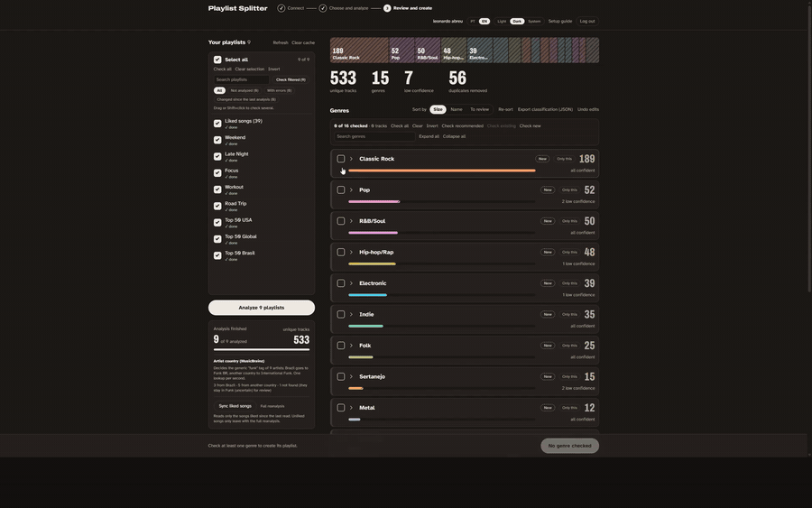

# Playlist Splitter

[English](README.md) · **Português (Brasil)**

Separa as músicas das suas playlists do Spotify (e das curtidas) por gênero e cria uma playlist para cada gênero. Você revisa tudo antes; nada muda no Spotify sem a sua confirmação, e as suas playlists originais nunca são alteradas.

> Projeto independente, não afiliado nem endossado pelo Spotify, pelo Last.fm ou pelo MusicBrainz.



**[Assista à demonstração de 2 minutos](https://youtu.be/CVqxI0cqT0M)**

## Como funciona

1. **Entre com o Spotify** usando o seu próprio app do Spotify (veja [Limites do Spotify](#limites-do-spotify-leia-primeiro)).
2. **Escolha as playlists** (e as curtidas). A análise roda em segundo plano; os gêneros vêm das tags do Last.fm.
3. **Revise:** um espectro de gêneros de tudo que você escolheu. Renomeie, junte ou mova faixas, confira as marcadas como baixa confiança e escolha quais gêneros criar.
4. **Confirme.** Gêneros novos viram playlists privadas novas, com nomes como `Rock (Playlist Splitter)`. Gêneros que já têm uma playlist são **atualizados**: só entram faixas novas, nada é removido nem reordenado.

Rode de novo sempre que a sua biblioteca mudar: as playlists que o app criou são reconhecidas (selo **Atualizar**; **Nova** quer dizer que uma playlist será criada) e atualizadas em vez de duplicadas.

## Recursos

- **Espectro de gêneros** das playlists escolhidas e das curtidas, agrupado em famílias (Rock, Pop, Hip-hop/Rap, Eletrônica, MPB, Funk BR…).
- **Revisão antes de criar:** renomear, juntar e marcar/desmarcar grupos; buscar, filtrar e mover faixas em lote; lista única de todas as faixas de baixa confiança; exportar a classificação em JSON; desfazer as edições.
- **Playlists existentes detectadas:** cada card de gênero mostra **Atualizar** ou **Nova**; **Marcar existentes** / **Marcar novos** selecionam cada grupo com um clique, e a confirmação lista o que será atualizado e o que será criado. A detecção usa o id da playlist guardado no navegador (sobrevive a renomeações) e, na falta dele, o nome padrão nos dois idiomas. Só playlists suas são consideradas.
- **Funk brasileiro x funk gringo:** tags de funk brasileiro vão para **Funk BR**; para artistas só com a tag "funk", o país do artista (MusicBrainz) decide entre **Funk BR** e **Funk Internacional**, e os de país desconhecido ficam em **Funk (incerto)** para revisão.
- **Duplicatas removidas** por ID do Spotify e por artista + título idênticos (versões como Remix, Slowed ou Ao Vivo continuam).
- **Consenso por artista:** quando as faixas confiáveis de um artista concordam numa família, as faixas dele sem família ou de baixa confiança vão junto (sem sobrescrever faixas confiáveis nem o que você moveu à mão).
- **Econômico com a cota:** tudo que é lido fica em cache no navegador (IndexedDB); **Sincronizar curtidas** lê só as curtidas novas; playlists criadas pelo app só são relidas quando o snapshot muda.
- **Bloqueio tratado:** quando o Spotify bloqueia o app (429 com Retry-After longo), ele para de chamar, mostra até quando e lembra disso ao recarregar.
- **Análise em segundo plano** com pausar/retomar, progresso por playlist e novas tentativas.
- **Interface em português (Brasil) e em inglês**, com tema claro, escuro ou do sistema.
- **Guia de configuração no app** em `/setup`, além de `npm run setup:env` e `npm run doctor`.

## Limites do Spotify (leia primeiro)

Não existe versão hospedada, e isso é de propósito: o Spotify só deixa um app em **Development Mode** atender poucas pessoas, então cada pessoa roda a própria cópia com o próprio app do Spotify.

- **Cada pessoa cria o próprio app do Spotify** no Developer Dashboard (o guia em `/setup` mostra como).
- **Até 5 usuários** por app, cada um cadastrado por e-mail em *User Management* (sem isso, toda chamada dá 403).
- **O dono do app precisa de Spotify Premium.**
- **Cota:** o Spotify limita quantas chamadas um app faz, e passar do limite pode bloqueá-lo por horas (`429`, `QUOTA_EXCEEDED`). O app enfileira as chamadas uma a uma, guarda tudo em cache e para quando é bloqueado em vez de insistir. Isso já aconteceu uma vez durante o desenvolvimento.
- **Sem gêneros pelo Spotify:** para apps em Development Mode, o Spotify removeu o campo `genres` dos artistas e os endpoints em lote. Veja [Como os gêneros são definidos](#como-os-gêneros-são-definidos).

## Início rápido

Requisitos: Node.js 20+ e uma conta Spotify Premium.

```bash
git clone https://github.com/leomitas/playlist-splitter.git
cd playlist-splitter
npm install
npm run setup:env   # cria o .env.local (nunca sobrescreve) e gera o AUTH_SECRET
npm run dev
```

Abra **http://127.0.0.1:3000/setup** (sempre `127.0.0.1`, nunca `localhost`) e siga os seis passos: criar o app no Spotify, cadastrar seu e-mail, pegar a chave do Last.fm, preencher o `.env.local` e reiniciar. Depois, `npm run doctor` confere a configuração sem mostrar nenhum valor.

Para uma experiência mais fluida (sem o selo do modo dev, páginas mais rápidas), dá para rodar a versão de produção no lugar do `npm run dev`: `npm run build && npm start`. Pare o servidor antes de fazer o build de novo.

## Estado do projeto e testes

O Playlist Splitter é um projeto jovem, construído e usado até agora por uma pessoa. Veja o que está e o que não está verificado.

**Automatizado:** 190+ testes (Vitest) com as APIs simuladas: classificação, duplicatas, consenso por artista, estado da revisão, i18n, contraste de cores (WCAG AA nos dois temas) e os principais comportamentos da interface. O CI roda lint, typecheck, testes e um build de produção em cada pull request.

**À mão, nas APIs reais** (Windows, Chrome, Spotify Premium, Last.fm e MusicBrainz de verdade): login; análise de cerca de 90 playlists (por volta de 4.900 faixas únicas) e de uma segunda conta com 9 playlists; criação de 15 playlists de gênero; reconhecimento delas depois (**Atualizar**); atualização de uma playlist; sincronização de uma música recém-curtida.

**Ainda não verificado:**

- A tela de bloqueio contra um `429` real do Spotify (só tem testes unitários).
- O botão "Testar configuração" do `/setup` com os serviços de verdade.
- macOS, Linux, Firefox e Safari.
- Contas diferentes da do autor (o Development Mode dificulta isso, então relatos são muito bem-vindos).

Achou um problema? [Abra uma issue](../../issues) com o que você fez e a mensagem que o app mostrou.

## Como os gêneros são definidos

O Spotify removeu o campo `genres` e os endpoints em lote (vários artistas por requisição) para apps em **Development Mode**, que é o modo de toda cópia deste app rodando localmente. Por isso os gêneros vêm das **tags do Last.fm** do artista (e da faixa, quando as do artista não bastam), mapeadas para famílias por uma lista simples em [`lib/genre-families.ts`](lib/genre-families.ts).

A tag genérica **"funk"** é ambígua (funk carioca e funk americano usam a mesma), então, para artistas sem tag de funk brasileiro, o app pergunta ao **MusicBrainz** o país do artista: Brasil → Funk BR, outro país → Funk Internacional (ainda competindo com as outras tags: R&B/Soul quando soul/R&B pesa mais, Jazz quando o jazz pesa), não encontrado → Funk (incerto). O país só vale num resultado confiável e exato (score ≥ 90, mesmo nome ou alias normalizado). O MusicBrainz permite **1 requisição por segundo**, então essas consultas rodam em segundo plano nesse ritmo (com pausa e tempo restante) e ficam em cache no navegador; "não encontrado" é consultado de novo depois de 14 dias.

As tags são feitas pela comunidade, então algumas faixas vão cair na família errada ou em **Outros**. É para isso que existe a etapa de revisão, e melhorar os mapeamentos é a forma mais fácil de contribuir.

## Privacidade

- **Sem banco de dados e sem contas.** A sessão fica num cookie criptografado; o que o app lê do Spotify fica em cache no seu navegador (IndexedDB) e não sai de lá. **Limpar cache** apaga tudo.
- Nomes de faixas e artistas são enviados ao **Last.fm** (e nomes de artistas ao **MusicBrainz**, só para a tag genérica "funk") para buscar tags e países, pelas rotas do próprio app na sua máquina.
- O Client Secret do Spotify, a chave do Last.fm e o `AUTH_SECRET` ficam no `.env.local`, que nunca é commitado. Nunca cole esses valores em issues ou capturas de tela.
- O app pede ao Spotify só as permissões de que precisa: ler suas playlists e curtidas, e criar ou editar playlists.

## Solução de problemas

| Sintoma | Solução |
|---|---|
| `INVALID_CLIENT: Invalid redirect URI` | Cadastre exatamente `http://127.0.0.1:3000/api/auth/callback/spotify` no Dashboard e use `AUTH_URL=http://127.0.0.1:3000`. |
| 403 depois do login, "user may not be registered" | Adicione seu e-mail do Spotify em Dashboard > User Management, saia e entre de novo. |
| 429 / `QUOTA_EXCEEDED` | Espere: o app mostra até quando está bloqueado. Tentar de novo só prolonga o bloqueio. Prefira **Sincronizar curtidas** a uma reanálise completa. |
| 403 citando Premium | O Premium do dono do app venceu. |
| O login volta para a tela inicial | Você abriu por `localhost`; use `http://127.0.0.1:3000`. |
| Continua "faltando variável" depois de editar o `.env.local` | Reinicie o servidor. No Windows, confira se nenhum processo antigo ficou na porta 3000 (`netstat -ano \| findstr :3000`). |
| Página sem estilo ou erros em `_next/static` | Você rodou `npm run build` com o servidor ligado. Pare o servidor e inicie de novo. |

A lista completa está em `/setup` (seção "Erros comuns"), e as mensagens de erro do app apontam para ela.

## Desempenho

| Medida | Resultado | Como |
|---|---|---|
| Mover uma faixa (reducer) | 0,06 ms | 4.344 faixas, Node 24, script Vitest |
| Mover 500 faixas de uma vez | 0,38 ms | idem |
| Marcar/desmarcar um gênero | < 0,01 ms | idem |
| Consenso por artista + coerência | 11,5 ms | 4.344 faixas; roda só quando chegam faixas novas, não em cliques |
| Linhas de faixa por grupo aberto | 100 por vez | antes: todas as linhas de todos os grupos (~127 mil nós no DOM) |
| Listagens de `/me/playlists` | 1 por sessão | as escritas atualizam a lista em cache |
| **Sincronizar curtidas** sem novidade | 1 requisição | reler 4.344 curtidas são 87 requisições |

Meta: todo clique abaixo de ~15 ms no navegador. A latência de clique no navegador não foi medida de novo nesta versão.

## Roadmap

- Importar o arquivo de dados do Spotify (download de privacidade) para analisar sem chamadas à API.
- Mais famílias e tags de gênero.
- Detectar descurtidas em **Sincronizar curtidas** sem releitura completa.
- Uma mensagem mais clara quando o servidor local não está acessível.

Veja [docs/good-first-issues.md](docs/good-first-issues.md).

## Como contribuir

Contribuições são bem-vindas, principalmente mapeamentos de gênero. Leia o [CONTRIBUTING.md](CONTRIBUTING.md) e o [Código de Conduta](CODE_OF_CONDUCT.md). Problemas de segurança: [SECURITY.md](SECURITY.md).

## Créditos

- Tags de gênero: [Last.fm](https://www.last.fm/api). País dos artistas: [MusicBrainz](https://musicbrainz.org/) (dados abertos, CC0). Biblioteca e playlists: [Spotify Web API](https://developer.spotify.com/documentation/web-api).
- Feito com o [Claude Code](https://claude.com/claude-code) como ferramenta de programação em par, e depois revisado e testado pelo autor.

## Licença

[MIT](LICENSE) © 2026 Leonardo Abreu Ramos de Oliveira
